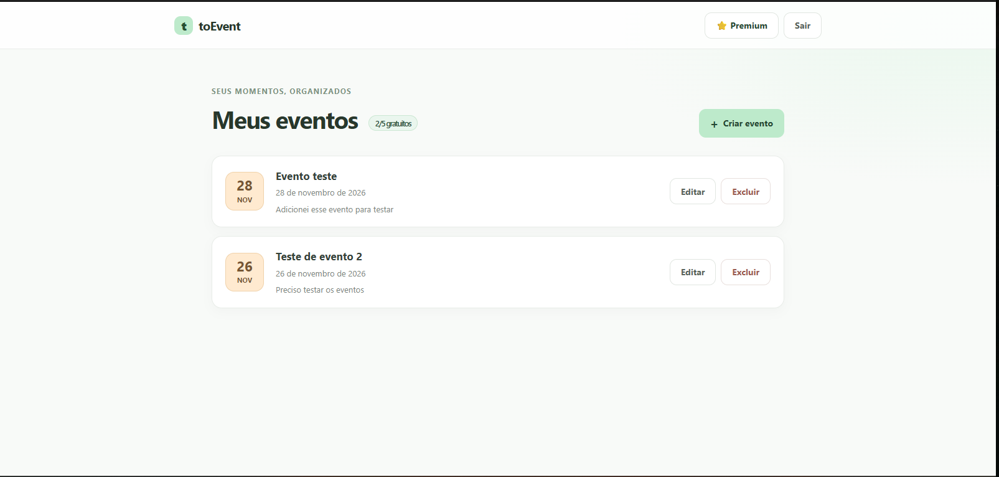
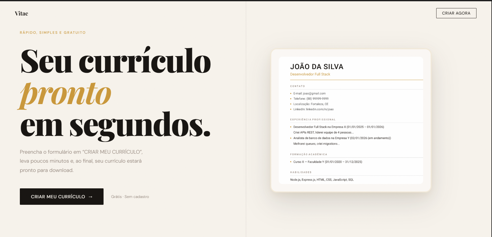

<h1 align="center">Olá, eu sou o Wesley Moreira 👋</h1>

  
  

  <b>Desenvolvedor Full Stack & Mobile</b> apaixonado por transformar problemas complexos em soluções eficientes, escaláveis e focadas na experiência do usuário.

---

## 🛠️ Tecnologias e Ferramentas

  <!-- Front-end & Mobile -->
  
  
  
  
  
  
  
  <!-- Back-end & Linguagens -->
  
  
  
  
  
  
  

  <!-- DevOps & Infra -->
  
  
  
  

---

## 🚀 Principais Projetos

### 📱 1. `toEvent` (Aplicação Web)
* **Tecnologias:** `React`, `Vite`, `React Router`, `Tailwind CSS`
* **Destaques:** Arquitetura limpa, rotas protegidas com autenticação stateless JWT e isolamento de dados por usuário.

---

### 📄 2. `Vitae` (Gerador de Currículos)
* **Tecnologias:** `EJS`, `JavaScript`, `CSS`
* **Destaques:** Ferramenta prática voltada para a criação e estruturação otimizada de currículos profissionais focados em ATS.

---

## 📊 Estatísticas do GitHub

  
  

---

## 📫 Conecte-se comigo

* **GitHub:** [@wesle-yey](https://github.com/wesle-yey)
* **Linkedin:** [@wesle-yey](https://linkedin.com/in/wesle-yey)
* **E-mail:** wesleymosousa@gmail.com
