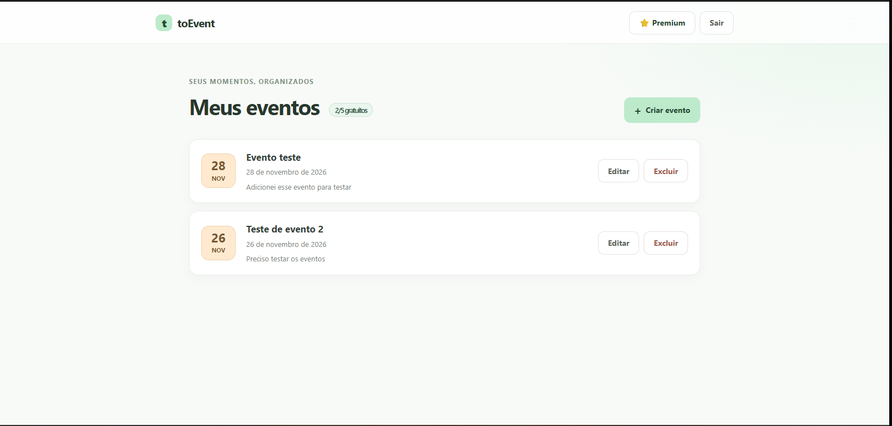
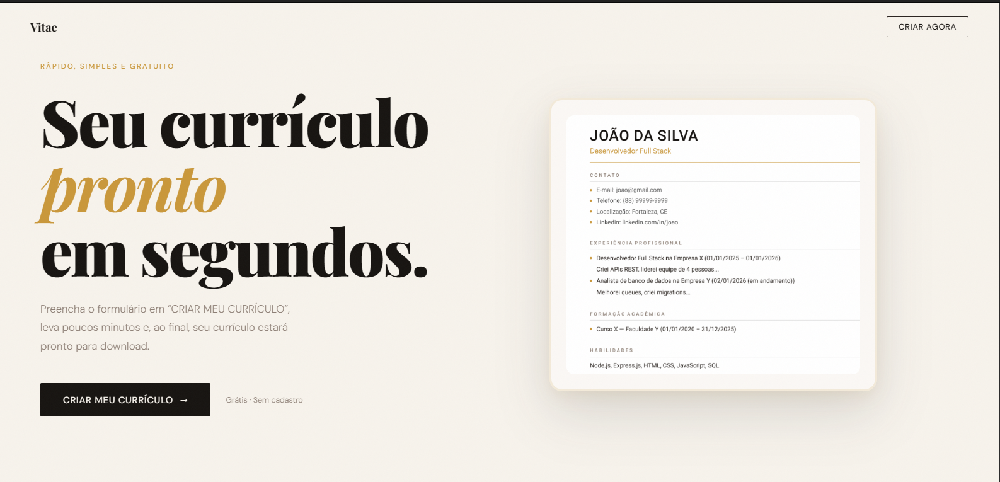

<h1 align="center">Olá, eu sou o Wesley Moreira 👋</h1>

  <b>Desenvolvedor Backend</b> · Java, Spring Boot e Python · Fortaleza, CE

  Graduado em Análise e Desenvolvimento de Sistemas (IFCE). Construo APIs REST com autenticação, testes e deploy em contêineres, e trabalho com integração de sistemas via SOAP/XML.

---

## 🛠️ Stack

  <!-- Backend -->
  
  
  
  
  
  

  <!-- Dados -->
  
  

  <!-- DevOps e testes -->
  
  
  
  

  <!-- Front-end e mobile -->
  
  

---

## 🚀 Projetos em destaque

### [toEvent](https://github.com/wesle-yey/toEvent) · [demo](https://to-event.vercel.app)
Aplicação para organizar eventos pessoais, com API REST própria.
- **Backend:** Java 17, Spring Boot, Spring Security, MongoDB, Docker Compose
- **Frontend:** React, Vite
- **Destaques:** autenticação JWT em cookie HttpOnly, confirmação de e-mail via API HTTP do Brevo com proteção contra envio em massa, bloqueio de e-mails temporários, rate limiting, isolamento de dados por usuário, regras de negócio por plano e 46 testes automatizados.

### [Codes-delivery](https://github.com/wesle-yey/Codes-delivery)
Backend de food delivery focado no fluxo de pedidos e avaliações.
- **Stack:** Java 17, Spring Boot, PostgreSQL, Docker
- **Destaques:** máquina de estados do pedido (criado → aceito/recusado → entregue → avaliado) e documentação da arquitetura e do modelo de dados.

### [API de Gerenciamento Escolar](https://github.com/wesle-yey/API-Gerenciamento-escolar)
API REST para cursos, alunos e professores.
- **Stack:** Python, FastAPI, pytest, GitHub Actions
- **Destaques:** autenticação, testes automatizados com cobertura e pipeline de CI/CD a cada push.

### [Vitae](https://github.com/wesle-yey/Vitae) · [demo](https://vitae-gamma.vercel.app)
Gerador de currículos em PDF a partir de um formulário.
- **Stack:** Node.js, Express, EJS, pdfmake

---

## 📫 Contato

- **LinkedIn:** [linkedin.com/in/wesle-yey](https://linkedin.com/in/wesle-yey)
- **E-mail:** wesleymosousa@gmail.com
